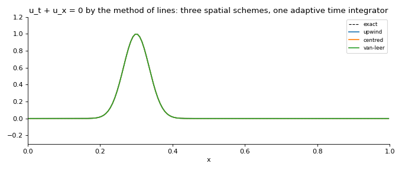
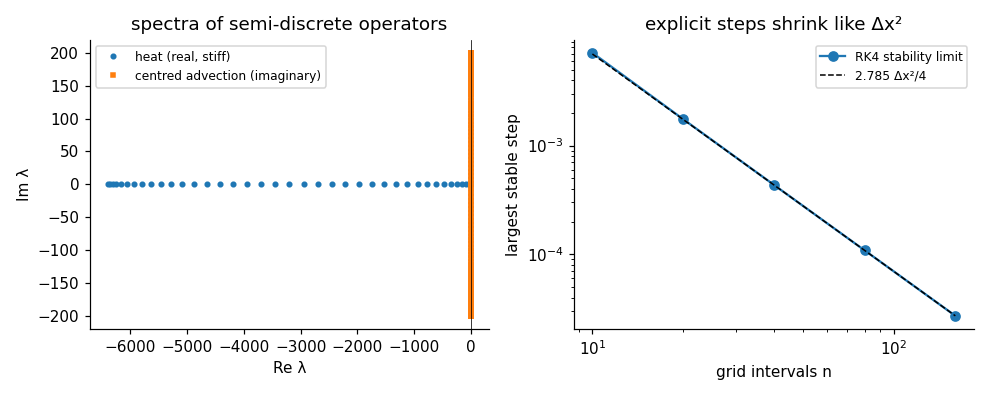
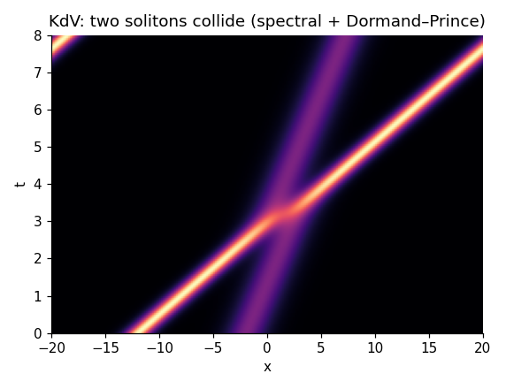
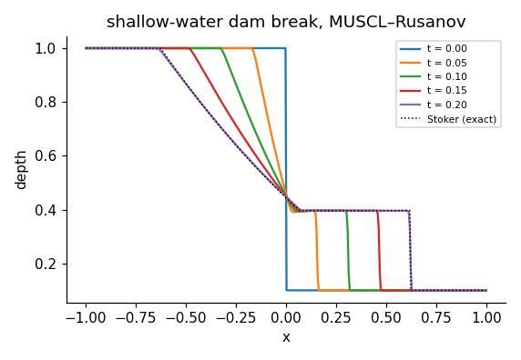
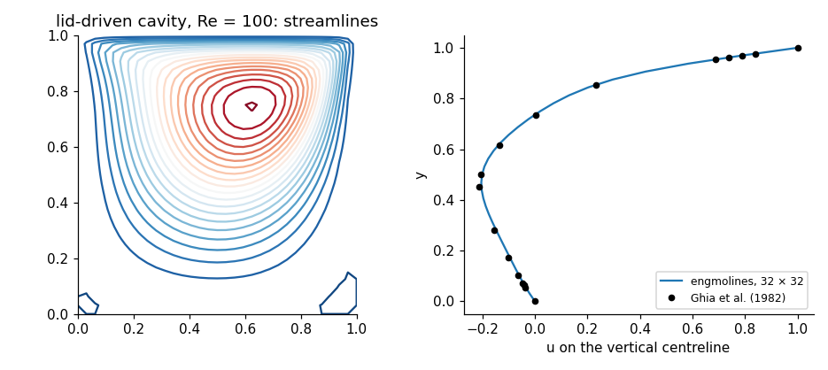
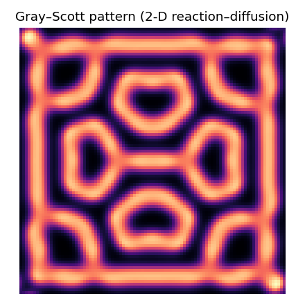
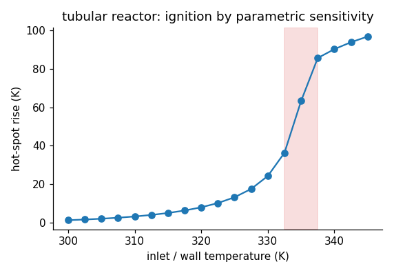

<div align="center">

# engmolines

**The numerical method of lines for engineering PDEs: a validated toolkit, 37 worked examples, and a 16-notebook course.**

[](https://github.com/ktwyw/engmolines/actions/workflows/tests.yml)
[](docs/VALIDATION.md)
[](notebooks)
[](pyproject.toml)
[](LICENSE)
[](https://orcid.org/0000-0002-8488-9833)



</div>

The method of lines discretises the space derivatives of a partial differential equation on a grid and hands
the resulting system of ordinary differential equations - one per grid point, usually large and stiff - to a
time integrator. `engmolines` implements that pipeline from scratch and teaches its craft: stencils of any
order with matched boundary closures, boundary conditions by ghost points, finite-volume fluxes with limiters,
Fourier spectral derivatives, the spectrum and stiffness of the semi-discrete system, explicit and implicit
integrators whose Newton iterations exploit the banded Jacobian (coloured finite differences, banded LU, one
factorisation for many steps), IMEX splitting, symplectic integration and DAEs - and 37 example problems
spanning parabolic, hyperbolic, dispersive, coupled and two-dimensional PDEs, each checked against an exact
solution or a benchmark. The core depends on NumPy only; SciPy is used to check it.

```python
import numpy as np
from engmolines import boundary as bc, grids, integrators as ti, operators as op, problems, stiffness

g = grids.uniform(0, 1, 40)                                                     # the heat equation in three lines
f = lambda t, u: op.diffusion(u, g, 1.0, bc.Dirichlet(0.0), bc.Dirichlet(0.0), t)
sol = ti.bdf(f, np.sin(np.pi * g.x), (0, 0.1), 0.005, order=4, band=(1, 1))     # 20 steps, one banded Jacobian

lam = stiffness.spectrum(f, sol.y[-1], band=(1, 1))                              # why implicit: eigenvalues to -4/dx^2
stiffness.explicit_step_limit(lam[lam.real < 0], "rk4")                         # 4.4e-4: the explicit step limit

p = problems.shallow_water_dam_break()                                           # 37 ready-made problems with exact solutions
s = p.solve("dopri", rtol=1e-7, atol=1e-9); p.error(s)                           # vs Stoker's solution
```

## Why engmolines?

- **The method of lines as a discipline, not a trick.** Every notebook separates the spatial error (measured
  against the PDE) from the temporal error (measured against the *exact solution of the semi-discrete system*,
  computed by the exponential integrator), reads the spectrum before choosing the integrator, and checks
  conservation, invariants and boundary values.
- **Stiffness made quantitative.** Spectra, stiffness ratios, stability functions and the largest stable step
  for any explicit method; von Neumann amplification of the fully discrete scheme; modified equations that
  predict the numerical diffusion of upwind to three digits; a cost model for explicit versus implicit.
- **Implicit steps that cost what they should.** Jacobians by column colouring (bandwidth + 1 evaluations),
  banded LU with pivoting, a modified Newton iteration that refreshes the Jacobian only when its convergence
  slows, Kronecker bands in 2-D - and the failures these methods can hide (a converged Newton iteration at a
  spurious root), demonstrated and diagnosed.
- **37 problems with answers.** Heat conduction in every geometry, composite walls, fins, Black-Scholes,
  nonlinear and degenerate diffusion (Barenblatt), Fisher fronts, Allen-Cahn, Cahn-Hilliard, Gray-Scott,
  Stefan melting, advection with limiters, Burgers' shocks, Stoker's dam break, strings, beams, the telegraph
  equation, KdV and NLS solitons, a packed-bed adsorber, a catalyst pellet, a counterflow exchanger, DAEs,
  a plate, a circular front, the lid-driven cavity against Ghia et al., and a cooled tubular reactor.
- **Validated.** 174 checks in [`docs/VALIDATION.md`](docs/VALIDATION.md), rerun in CI with warnings as errors:
  measured orders of ten integrators and of every stencil, exact decay rates, Rankine-Hugoniot speeds,
  conserved invariants to 10⁻¹⁴, benchmarks within their resolution.

## What's inside

| Module | Contents |
|---|---|
| `grids` | node-centred, cell-centred, periodic, stretched (clustered) and radial grids, 2-D tensor grids, control-volume integration |
| `stencils` | Fornberg weights on any points; differentiation operators of any derivative and accuracy with matched one-sided closures; upwind-biased stencils; stencil (diagonal) storage applied in O(n), convertible to dense or banded; Kronecker sums |
| `boundary` | Dirichlet, Neumann, Robin, periodic and time-dependent conditions by ghost points on node and cell grids, 2-D ghost cells, clamped/pinned/free beam ends |
| `operators` | conservative diffusion with variable coefficients in planar, cylindrical and spherical geometry; advection by centred, upwind and flux-limited (minmod, superbee, van Leer, MC, Koren) schemes; dispersion; the biharmonic beam operator; the 2-D Laplacian; MUSCL-Rusanov finite volumes for scalar and system conservation laws |
| `spectral` | Fourier spectral derivatives, 2/3-rule dealiasing, wavenumbers and spectral eigenvalue bounds |
| `linalg` | banded LU with partial pivoting, coloured banded Jacobians, dense fallbacks |
| `integrators` | fixed-step and adaptive (Dormand-Prince 5(4), PI control, dense output) explicit Runge-Kutta; backward Euler, the trapezoidal rule, BDF 1-5 with Radau IIA start and banded modified Newton; IMEX Euler and CNAB2; the exponential integrator; Stormer-Verlet; BDF for index-1 DAEs |
| `stiffness` | Jacobian spectra, stiffness ratios, stability functions, explicit step limits, theoretical operator extremes, a cost model |
| `analysis` | stencil symbols, von Neumann amplification of fully discrete schemes, maximum stable steps, modified equations, convergence studies, conservation and wave energy |
| `problems` | the 37 example problems as `Problem` objects: grid, right-hand side, initial state, Jacobian band, exact or reference solution |
| `datasets` | the reactor temperature profiles of the project |

## Learn: the course

Sixteen executed notebooks, each with learning objectives, an "Inside the algorithm" cell that rebuilds a
method by hand and checks it against the library, and exercises with an "Implement it yourself" task; every
exercise has a worked solution in [`solutions/`](solutions). They open in Google Colab.

| # | Notebook | What it establishes |
|---|---|---|
| 00 | [What is the method of lines?](notebooks/00_what_is_the_method_of_lines.ipynb) | the heat equation in twenty lines; the exact semi-discrete solution; stiffness |
| 01 | [Stencils and boundary conditions](notebooks/01_stencils_and_boundary_conditions.ipynb) | Fornberg weights, orders with closures, ghost points, stretched grids |
| 02 | [Stiffness and choosing the integrator](notebooks/02_stiffness_and_choosing_the_integrator.ipynb) | spectra, stability regions, A- vs L-stability, ringing, a cost model |
| 03 | [Banded Newton and the cost of implicit steps](notebooks/03_banded_newton_and_the_cost_of_implicit_steps.ipynb) | colouring, banded LU, the modified Newton, a spurious converged root |
| 04 | [The heat equation in every form](notebooks/04_the_heat_equation_in_every_form.ipynb) | boundary types, space-time convergence, layers, cylinders, spheres, a fin |
| 05 | [Nonlinear diffusion](notebooks/05_nonlinear_diffusion.ipynb) | conductivity, the porous-medium front, Allen-Cahn, Cahn-Hilliard |
| 06 | [Reaction-diffusion: fronts and patterns](notebooks/06_reaction_diffusion_fronts_and_patterns.ipynb) | KPP speed, IMEX splitting, 2-D fronts, Gray-Scott |
| 07 | [Advection: the hard case](notebooks/07_advection_the_hard_case.ipynb) | imaginary spectra, modified equations, limiters, inflow and Danckwerts conditions |
| 08 | [Shocks and conservation laws](notebooks/08_shocks_and_conservation_laws.ipynb) | Burgers, Riemann problems, finite volumes, the dam break |
| 09 | [Waves, strings and beams](notebooks/09_waves_strings_and_beams.ipynb) | Verlet vs RK4 vs BDF, beam stiffness, damping, a moving load |
| 10 | [Dispersive waves and spectral methods](notebooks/10_dispersive_waves_and_spectral_methods.ipynb) | solitons, n³ stiffness, invariants, aliasing |
| 11 | [Coupled systems and DAEs](notebooks/11_coupled_systems_and_daes.ipynb) | adsorber, pellet, exchanger, the heat equation as a DAE |
| 12 | [Two dimensions](notebooks/12_two_dimensions.ipynb) | Kronecker bands, a plate, a circular front, the lid-driven cavity |
| 13 | [Diagnosing failures](notebooks/13_diagnosing_failures.ipynb) | eight staged failures with their symptoms, tests and fixes |
| 14 | [Moving boundaries and transformed domains](notebooks/14_moving_boundaries_and_transformed_domains.ipynb) | Stefan melting, Black-Scholes, boundary layers on stretched grids |
| 15 | [Project: runaway in a tubular reactor](notebooks/15_project_runaway_in_a_tubular_reactor.ipynb) | fit kinetics through the model, find the ignition boundary, report |

The theory behind each method, with references, is in [`docs/THEORY.md`](docs/THEORY.md). The ODE integrators
and finite-difference ideas used here are developed from first principles in the companion
[engnumeric](https://github.com/ktwyw/engnumeric).

## Gallery

Every image is computed by the library; `python tools/make_images.py` regenerates them.

| | |
|:-:|:-:|
| <br>Spectra of semi-discrete operators, and the Δx² law of explicit steps | <br>Two KdV solitons collide: spectral space, adaptive time, invariants to 10⁻¹⁴ |
| <br>Stoker's dam break by MUSCL-Rusanov finite volumes | <br>The lid-driven cavity at Re = 100 against Ghia et al. |
| <br>A Gray-Scott pattern from noise | <br>Ignition of a cooled tubular reactor by parametric sensitivity |

## Install

```bash
pip install "engmolines @ git+https://github.com/ktwyw/engmolines"
# with the notebook dependencies (SciPy, Matplotlib, pandas, JupyterLab):
pip install "engmolines[notebooks] @ git+https://github.com/ktwyw/engmolines"
# or, for development:
git clone https://github.com/ktwyw/engmolines && cd engmolines && pip install -e ".[dev]"
```

## Validation at a glance

| Reference | What is checked | Agreement |
|---|---|---|
| Exact PDE solutions | heat conduction (Dirichlet, Neumann, Robin, periodic forcing), composite walls, Bessel and spherical modes, the cosh/sinh fin, Black-Scholes, Barenblatt, Allen-Cahn kinks, Neumann's Stefan solution, Burgers' Riemann problems and characteristics, Stoker's dam break, standing waves, telegraph, KdV and NLS solitons, Danckwerts, Thiele, NTU | 10⁻³ to 10⁻¹² |
| Exact semi-discrete solutions | the exponential integrator vs `scipy.linalg.expm`; measured time orders of BDF1-5, trapezoidal, RK4, IMEX, Verlet against it | orders within 0.1-0.3 |
| SciPy, LAPACK | banded LU vs `solve_banded`, coloured vs dense Jacobians, BDF vs Radau, DAE vs reduced ODE | 10⁻⁶ to 10⁻¹⁵ |
| Stability theory | RK4's 2.785 and Euler's 2 on the real axis, CFL 1 (upwind+Euler) and 2.83 (centred+RK4), FTCS r ≤ ½, A-stability, BDF2's damping, the Δx² and Δx⁻⁴ scalings, operator extremes −4/Δx², ±ia/Δx, (πn/L)³ | 10⁻⁶ |
| Conservation and structure | flux-form mass to 10⁻¹², KdV and NLS invariants to 10⁻¹⁴, Cahn-Hilliard energy monotone, Verlet energy bounded, TVD limiters, positivity | exact or 10⁻¹² |
| Benchmarks | Ghia et al. (1982) cavity centreline velocities and vortex strength | within 5 % on 32 × 32 |

## Citing

If `engmolines` helps your work, please cite it using [`CITATION.cff`](CITATION.cff).

## Author

**Yanwei Wang** - personal open-source project.
[GitHub @ktwyw](https://github.com/ktwyw) · [ORCID 0000-0002-8488-9833](https://orcid.org/0000-0002-8488-9833) ·
wangyanwei@gmail.com

Also by the author: [engnumeric](https://github.com/ktwyw/engnumeric), [engmath](https://github.com/ktwyw/engmath),
[engstat](https://github.com/ktwyw/engstat), [fluidmech](https://github.com/ktwyw/fluidmech),
[engrheo](https://github.com/ktwyw/engrheo), [engthermo](https://github.com/ktwyw/engthermo),
[engcolloid](https://github.com/ktwyw/engcolloid), [engdiscrete](https://github.com/ktwyw/engdiscrete),
[engreact](https://github.com/ktwyw/engreact), [engsep](https://github.com/ktwyw/engsep) and
[engbalance](https://github.com/ktwyw/engbalance).

## License

MIT - see [LICENSE](LICENSE). Contributions welcome: see [CONTRIBUTING.md](CONTRIBUTING.md).
